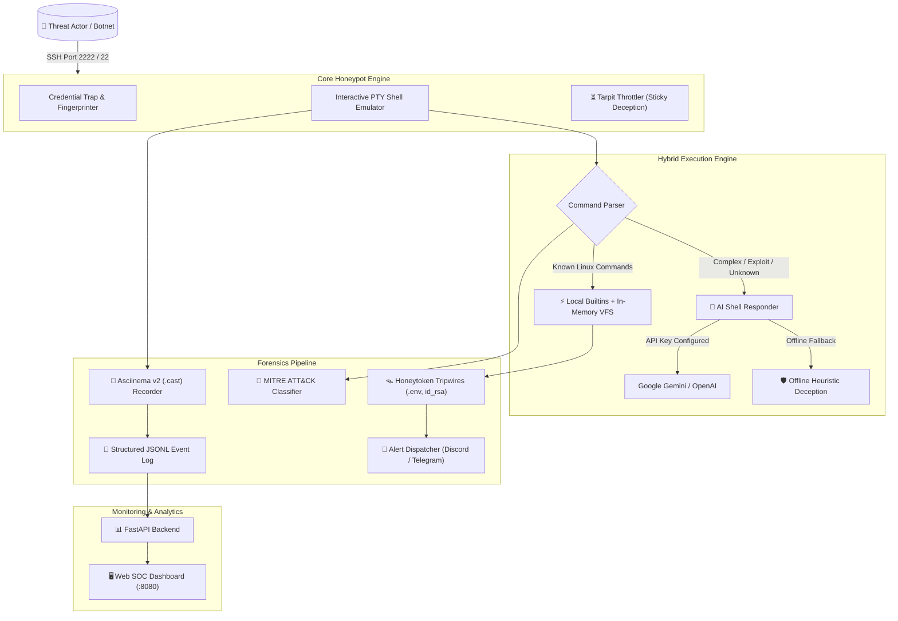

# MirageSSH: AI-Augmented Adaptive SSH Honeypot & Forensics Tarpit

<div align="center">

```
  __  __ _                    ____ ____  _   _ 
 |  \/  (_)_ __ __ _  __ _  / ___/ ___|| | | |
 | |\/| | | '__/ _` |/ _` | \___ \___ \| |_| |
 | |  | | | | | (_| | (_| |  ___) |__) |  _  |
 |_|  |_|_|_|  \__,_|\__, | |____/____/|_| |_|
                      |___/                    
```

**Adaptive Deception Honeypot Powered by Dynamic LLM Generation, In-Memory Linux VFS, Sticky Tarpit & Real-Time MITRE ATT&CK® Telemetry.**

[](.github/workflows/ci.yml)
[](https://www.python.org/)
[](LICENSE)
[](Dockerfile)
[](https://attack.mitre.org/)

[English](README.md) • [Bahasa Indonesia](README.id.md)

</div>

---

## 🌟 Overview

**MirageSSH** is an open-source, medium-interaction SSH honeypot engineered to trap automated threat actors, botnets, and human adversaries. By combining an **in-memory Virtual Linux File System (VFS)** with a **dynamic AI responder engine (Google Gemini / OpenAI / Offline Heuristics)**, MirageSSH generates authentic, context-aware terminal output for unpredictable commands and exploit payloads.

Attackers are trapped in a sticky **Tarpit** environment where their keystrokes, timing, and commands are recorded into **Asciinema v2 (`.cast`)** files and classified in real-time against the **MITRE ATT&CK® Enterprise Matrix**.

---

## ⚔️ Why MirageSSH? (Comparison)

| Feature | MirageSSH | Traditional Cowrie | High-Interaction (Real VM/Docker) |
|---|---|---|---|
| **Containment Safety** | **100% In-Memory Sandbox** (Zero breakout risk) | Medium | ⚠️ High Risk (Attacker can pivot / abuse container) |
| **Response Realism** | **Infinite Depth via LLM + Fast-Path** | Static canned outputs | 100% (Real Linux OS) |
| **Obscure Commands / Exploits** | **Plausible simulated execution** | "command not found" (reveals honeypot) | Real execution |
| **Session Replay** | **Asciinema v2 (`.cast`) + Web SOC Player** | Custom TTY format | Auditd / TTY logging |
| **Honeytoken Canaries** | **Built-in (.env, id_rsa, db_dump, AWS)** | Manual setup | Manual setup |
| **MITRE ATT&CK Mapping** | **Automatic Real-time TTP Classification** | None | Requires external SIEM |
| **Web SOC Dashboard** | **Built-in Dark Cyberpunk Dashboard** | Requires external ELK | Requires Grafana/Splunk |
| **Offline Resilience** | **Zero-API-Key Mock Heuristic Fallback** | N/A | N/A |

---

## 🚀 Key Features

### 1. 🧠 Hybrid Execution Engine (Fast-Path + AI Responder)
- **Local Fast-Path**: Common commands (`ls`, `cd`, `pwd`, `cat`, `whoami`, `id`, `uname`, `ps`, `top`, `uptime`, `ip a`, `ping`, `echo > file`) execute locally in sub-milliseconds with genuine state persistence.
- **AI Shell Responder**: Unknown commands, complex one-liners, exploit payloads, and reconnaissance scripts are routed to Google Gemini or OpenAI to generate authentic Linux terminal output.
- **Offline Heuristics Fallback**: Works 100% out of the box without requiring API keys.

### 2. 🪤 Honeytoken Tripwires & Sensitive Canaries
Pre-loaded with realistic decoy assets:
- `/home/ubuntu/.env`: Fake AWS keys, Stripe live keys, and production DB passwords.
- `/home/ubuntu/.aws/credentials`: Decoy AWS CLI configuration.
- `/root/.ssh/id_rsa`: Fake RSA private key trap.
- `/etc/shadow`: Unshadowable bait hashes.
- `/var/backups/prod_database.sql`: Fake customer SQL database with decoy credit cards.

*Any read, download, or modification immediately triggers a CRITICAL incident alert.*

### 3. ⏳ Sticky Tarpit Deception Engine
- Dynamically throttles response times (0.2s - 2.5s) on aggressive enumeration commands (`nmap`, `find / -perm -4000`, `cat /etc/shadow`).
- Exhausts botnet automation cycles and keeps human hackers engaged while defenders gather threat intelligence.

### 4. 🎯 Automated MITRE ATT&CK® Classification
Every executed command is mapped on-the-fly to ATT&CK techniques:
- **T1033**: System Owner/User Discovery (`whoami`, `id`)
- **T1082**: System Information Discovery (`uname -a`, `cat /proc/version`)
- **T1016**: System Network Configuration Discovery (`ip a`, `netstat`)
- **T1087**: Account Discovery (`cat /etc/passwd`)
- **T1003**: OS Credential Dumping (`cat /etc/shadow`)
- **T1552**: Unsecured Credentials in Files (`.env`, `id_rsa`)
- **T1105**: Ingress Tool Transfer (`curl`, `wget`)
- **T1059**: Command & Scripting Interpreter (Reverse shells, bash scripts)

### 5. 📼 Asciinema v2 (`.cast`) Keystroke Recording
Every session records raw input and output streams with millisecond timing. Analysts can replay hacker sessions like a movie using:
```bash
asciinema play data/recordings/<session_id>.cast
```

### 6. 📊 Real-Time Cyberpunk SOC Web Dashboard
Built with FastAPI, Tailwind CSS, and Chart.js:
- Live metrics (Active Attackers, Total Sessions, Unique IPs, Honeytoken Breaches).
- Attack Origin Geo Breakdown & Country flags.
- MITRE ATT&CK frequency distribution.
- Interactive Session Forensics Modal with in-browser terminal command log.

### 7. 🚨 Instant Multi-Channel Intrusion Alerting
Dispatches real-time security alerts to:
- **Discord Webhook** (formatted embed with IP, country, and breached token).
- **Telegram Bot** (instant push notification to your phone).
- **Generic HTTP Webhook** (SIEM ingestion).

---

## 🏗️ System Architecture



---

## ⚡ Quickstart Guide

### Option A: 1-Command Docker Deployment (Recommended)

1. **Clone the repository:**
   ```bash
   git clone https://github.com/yourusername/miragessh.git
   cd miragessh
   ```

2. **Configure environment (Optional for AI & Alerts):**
   ```bash
   cp .env.example .env
   # Add your GEMINI_API_KEY or DISCORD_WEBHOOK_URL if desired
   ```

3. **Start with Docker Compose:**
   ```bash
   docker compose up -d
   ```

4. **Access the SOC Dashboard:**
   Open your browser at `http://localhost:8080`

---

### Option B: Local Python Installation

1. **Clone and enter repository:**
   ```bash
   git clone https://github.com/yourusername/miragessh.git
   cd miragessh
   ```

2. **Create and activate a virtual environment:**
   ```bash
   python -m venv venv
   # Linux / macOS:
   source venv/bin/activate
   # Windows:
   .\venv\Scripts\activate
   ```

3. **Install dependencies:**
   ```bash
   pip install -r requirements.txt
   ```

4. **Launch MirageSSH:**
   ```bash
   python -m miragessh
   ```

---

## 🧪 Testing with the Simulated Attacker Demo

MirageSSH includes an automated attack script that connects over SSH, runs multi-stage recon, trips a Honeytoken, and downloads a fake dropper:

```bash
python scripts/demo_attack.py 127.0.0.1 2222
```

Watch the Web SOC Dashboard (`http://localhost:8080`) update in real-time as the attack unfolds!

---

## 📂 Project Structure

```
miragessh/
├── .github/workflows/ci.yml      # Automated GitHub CI pipeline
├── config/
│   ├── default_config.yaml       # Core honeypot configuration
│   └── vfs_manifest.json         # Ubuntu 22.04 LTS directory & honeytoken blueprint
├── data/
│   ├── logs/                     # Structured JSONL & text logs
│   ├── recordings/               # Asciinema (.cast) terminal recordings
│   └── host_keys/                # RSA host keys (auto-generated)
├── src/
│   └── miragessh/
│       ├── __init__.py
│       ├── __main__.py           # python -m miragessh entrypoint
│       ├── cli.py                # CLI parser & banner
│       ├── server/               # SSH server daemon, PTY emulator & tarpit
│       ├── shell/                # Virtual File System (VFS) & builtin commands
│       ├── ai/                   # Gemini, OpenAI & Mock heuristic responders
│       ├── telemetry/            # MITRE ATT&CK, Asciinema, Honeytokens, GeoIP
│       └── web/                  # FastAPI Web SOC Dashboard & templates
├── scripts/
│   ├── demo_attack.py            # Automated multi-stage attack simulator
│   └── generate_keys.py          # Standalone RSA key generator
├── tests/                        # 100% Passing Pytest unit tests
├── Dockerfile                    # Multi-stage production container
├── docker-compose.yml            # 1-command deployment
├── requirements.txt              # Production dependencies
├── pyproject.toml                # Modern Python packaging
└── LICENSE                       # MIT License
```

---

## ⚙️ Configuration Reference (`config/default_config.yaml`)

```yaml
server:
  host: "0.0.0.0"
  port: 2222
  banner: "SSH-2.0-OpenSSH_8.9p1 Ubuntu-3ubuntu0.7"

authentication:
  mode: "tarpit_then_allow"      # Reject first 2 attempts, accept 3rd (brute-force trap)
  tarpit_fail_attempts: 2
  default_user: "ubuntu"

tarpit:
  enabled: true
  min_delay_ms: 250
  max_delay_ms: 1200
  suspicious_command_delay_ms: 2000

ai_responder:
  enabled: true
  provider: "gemini"             # 'gemini', 'openai', or 'mock'
  model: "gemini-1.5-flash"
  fallback_to_mock: true         # Resilient offline heuristics

honeytokens:
  paths:
    - "/home/ubuntu/.env"
    - "/root/.ssh/id_rsa"
    - "/etc/shadow"
    - "/var/backups/prod_database.sql"
```

---

## 🔒 Security & Ethics Notice

> [!CAUTION]
> **Defensive Security & Research Use Only**: MirageSSH is intended strictly for authorized cybersecurity research, education, and defense telemetry on networks you own or have explicit permission to monitor. Never use deceptive technologies to entrap users without appropriate organizational authorization and legal compliance.

---

## 📄 License

This project is licensed under the [MIT License](LICENSE).
